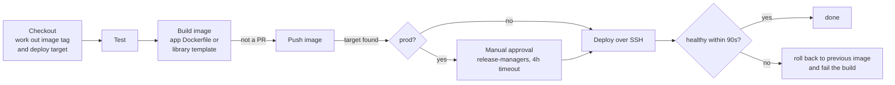

# jenkins-pipeline-library

A Jenkins shared library that gives every app the same delivery pipeline (test, build an image, push, deploy, roll back if unhealthy) from a Jenkinsfile of about ten lines.


## Why this exists

At work I once inherited 50-60 Jenkinsfiles for about ten apps. Each app had a copy per environment, and each copy had drifted a little: a different Docker login, a missing health check, a test step someone commented out. Changing how we deployed meant editing dozens of files and hoping you found them all.

I consolidated them into one generic pipeline plus two Dockerfile templates. This repo is a clean, from-scratch rebuild of that idea, written so anyone can read and run it. It contains no code from that job.

The rule the design follows: **an app describes itself, and the library decides how to ship it.**

## What an app's Jenkinsfile looks like

```groovy
@Library('pipeline-library@v1') _

deliveryPipeline(
    appName: 'claims-api',
    appType: 'dotnet-api',
    registry: 'registry.example.com/platform',
    environments: [
        dev    : [host: 'dev-app-1'],
        staging: [host: 'stg-app-1'],
        prod   : [host: 'prod-app-1'],
    ]
)
```

That is the whole file. More in [`examples/`](examples).

## What the pipeline does



**Where a build deploys to**

| What was built | Deploys to | Approval |
|---|---|---|
| Pull request | nowhere (image is built to prove it builds, never pushed) | |
| `main` | dev | |
| `release/*` | staging | |
| tag `v1.2.3` | prod | yes, by `prodApprovers` |
| any branch with `DEPLOY_TO=dev` or `staging` | that environment | |
| anything else | nowhere | |

Prod can't be chosen by hand from the build parameters. The only way in is a version tag, so every prod image maps to a tag in git.

**Image tags** are `1.2.3` for releases and `<branch>-<short sha>-<build>` otherwise (for example `main-3f9c2ab-57`), so any running container traces back to its commit.

## Layout

```
vars/deliveryPipeline.groovy          the pipeline (what Jenkinsfiles call)
src/dev/prajwal/pipeline/
  PipelineConfig.groovy               settings, app-type defaults, validation
  Environments.groovy                 branch/tag -> environment rules
  Version.groovy                      image tag rules
resources/dev/prajwal/pipeline/
  dockerfiles/                        templates for dotnet-api, java-service, node-ui
  deploy/deploy.sh                    runs on the host: swap container, health check, roll back
test/groovy/                          Spock specs, including a run of the whole pipeline with stubbed steps
scripts/test-deploy.sh                runs deploy.sh against real Docker (good deploy, then forced rollback)
```

## Design decisions

- **Logic lives in plain classes, not in the pipeline script.** Branch rules, tags and validation are in `src/` as ordinary Groovy, so they are unit tested in milliseconds without a Jenkins instance. The `vars/` script is mostly wiring.
- **Bad config fails before anything runs, with every problem listed at once.** A typo like `enviroments:` is reported as an unknown setting instead of silently deploying nowhere.
- **App types instead of per-app copies.** `dotnet-api`, `java-service` and `node-ui` carry defaults (test command, Dockerfile template, health path, port). An app overrides only what is different. Adding a fourth type is one map entry and one template.
- **The deploy host does the health check, not Jenkins.** `deploy.sh` keeps the previous image name, starts the new one, polls the health endpoint, and puts the old container back if it never becomes healthy. A bad release costs about 90 seconds of retries, not an outage that waits for someone to notice.
- **Pull requests build but never push.** That proves the Dockerfile works without filling the registry with throwaway images.
- **No concurrent builds per branch**, so two deploys never race on the same host.
- **Secrets stay in Jenkins credentials** (`docker-registry`, `deploy-<env>` SSH keys) and per-host env files (`/etc/apps/<app>.env`). Nothing secret is in the library or in app repos.

## Running the tests

```bash
gradle test                 # 24 Spock tests: config, branch rules, tags, and the full pipeline with stubbed steps
./scripts/test-deploy.sh    # needs Docker: deploys a healthy image, then a broken one that must roll back
shellcheck resources/dev/prajwal/pipeline/deploy/deploy.sh
```

`DeliveryPipelineSpec` loads `vars/deliveryPipeline.groovy` with a small harness that records each Jenkins step instead of running it. That is how the tests check, for example, that a pull request never reaches `docker push`, and that the local image and workspace are cleaned up even when tests fail.

## Using it in Jenkins

1. *Manage Jenkins → System → Global Trusted Pipeline Libraries*: add this repo as `pipeline-library`, default version `v1`.
2. Create credentials: `docker-registry` (username/password) and one SSH key per environment, `deploy-dev`, `deploy-staging`, `deploy-prod`, for a `deploy` user on each host.
3. Needs the Pipeline, Credentials Binding, SSH Agent and Workspace Cleanup plugins, and Docker on the agents.

Tag the library (`v1`, `v1.1`, ...) so a change to the pipeline is rolled out to apps deliberately, not the moment it is merged.

## What I'd add next

- Blue-green deploys behind nginx for zero-downtime releases (today there are a few seconds between stopping the old container and the new one answering).
- An image scan (Trivy) stage that fails on critical CVEs.
- Kubernetes as a deploy target alongside plain Docker hosts.
